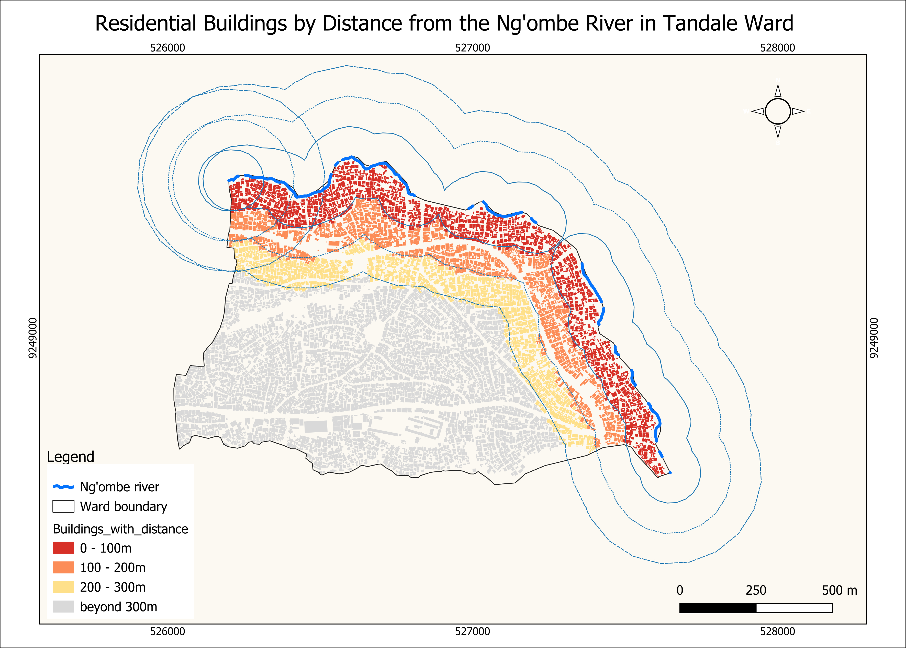

# Month 1 Summary

**Question, restated:** Which residential buildings in Tandale Ward fall within 100m, 200m, or 300m of the Ng'ombe River?

**Operation run:** A river buffer at three distances (100m, 200m, 300m) in EPSG:32737, then each building was classified by whether its centroid fell within each buffer ring. The river's two line segments were dissolved into one feature before the distance join, to avoid duplicate results at points equidistant between segments. Buffer + spatial classification was chosen because the question is framed as distance bands, not a simple in/out flood zone, so a plain intersection wouldn't capture the tiered structure the project needs.

## What I expected (numeric, written before running)

- The 0–100m band would hold a few hundred to about 2,000 of the 7,629 buildings.
- Each wider ring would hold more buildings than the ring inside it, so the 200–300m ring would be larger than the 0–100m ring.

## What I got

| Band | Buildings |
|---|---|
| 0–100m | 1,287 |
| 100–200m | 1,090 |
| 200–300m | 1,057 |
| Beyond 300m | 4,195 |
| **Within 300m** | **3,434 (45.0% of 7,629)** |

The 300m buffer covers 46.0% of the ward's total area.

- Prediction 1: **correct.** 1,287 is inside the range I expected.
- Prediction 2: **wrong.** The 100–200m and 200–300m rings (1,090 and 1,057) are both smaller than the 0–100m ring (1,287), even though each ring covers more area.

## The four checks

| # | Check | What I did | Result |
|---|---|---|---|
| 1 | Look at the map | Opened the classified layer with the river and ward boundary on top | Red (0–100m) hugs the river along the northern and eastern edges. Grey (beyond 300m) sits only in the southwest, furthest from the river. Legend bands match the colours. |
| 2 | Row count vs expected | Expected 7,629 rows (the buildings layer). Counted rows after classification, and unique `osm_id` values | 7,629 rows and 7,629 unique ids. The four bands sum to 7,629. My first QGIS run returned 7,677, which is 48 extra rows. The cause was the river's two line segments: buildings tied between them were joined twice. Dissolving the river into one feature fixed it. |
| 3 | One building verified by hand | Picked building `524655789`, centroid (527310.49, 9249224.82). Found the nearest point on a river segment by arithmetic: (527360.04, 9249231.03) | Distance = √(49.55² + 6.21²) = **49.94 m**, which matches the tool's 49.94 m. 49.94 m falls in the 0–100m band, and the building is in that band. |
| 4 | Empty geometry | Checked all 7,629 buildings for empty, null and invalid geometry | **0 empty, 0 null, 0 invalid.** |

**Edge note:** Recomputing with exact distances instead of the buffer polygon puts one more building inside 300m (3,435). Building `340110877` is 299.89m from the river and falls just outside the straight-edged buffer polygon. The share is 45.0% either way.

## What surprised me

My second prediction was wrong. The three bands are close in size (1,287 / 1,090 / 1,057) instead of growing with distance, even though each ring is bigger. Building density is highest right next to the river and thins out with distance, which roughly cancels the larger ring area. The duplicate-row bug in check 2 was the other surprise: the row-count check caught an error that would have inflated every band.

## Answering the project's question

Within Tandale Ward, 45.0% of residential buildings (3,434 of 7,629) sit within 300m of the Ng'ombe River. The highest concentration, 1,287 buildings, is in the innermost 100m band. Disaster-management and public-health teams can start with the 0–100m band, which holds the most buildings in the smallest, highest-risk footprint.

## What data I still need

The river geometry has unmapped gaps in the northeast (flagged in Weeks 2 and 3), so the buffer is incomplete along those stretches and some buildings there may be under-classified. I also need a way to confirm which "residential" buildings are occupied homes rather than vacant or non-residential structures that still carry a generic OSM tag, since that changes how these counts should be read for public-health prioritisation.
